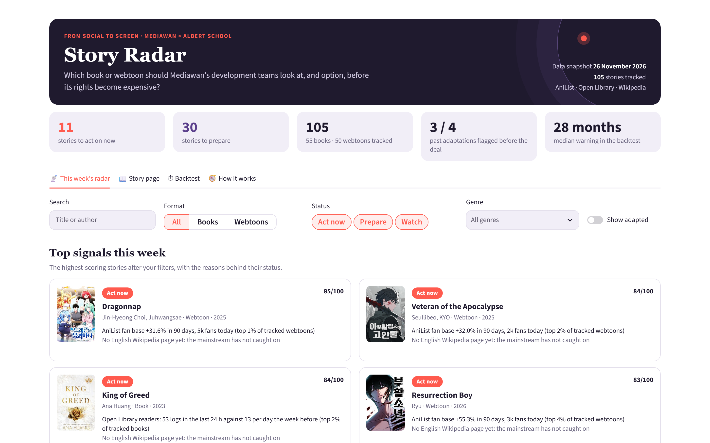
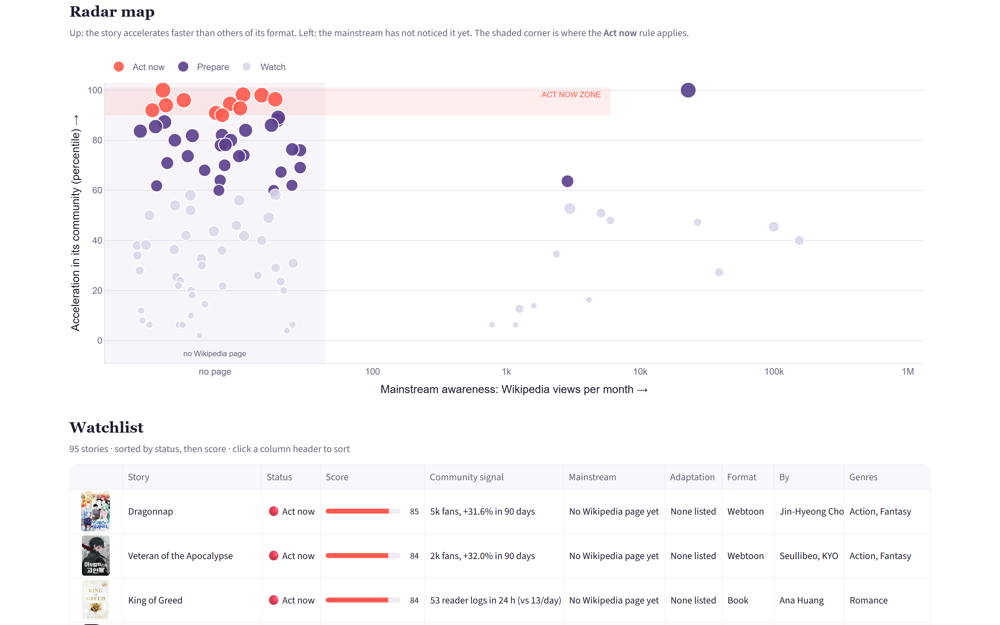
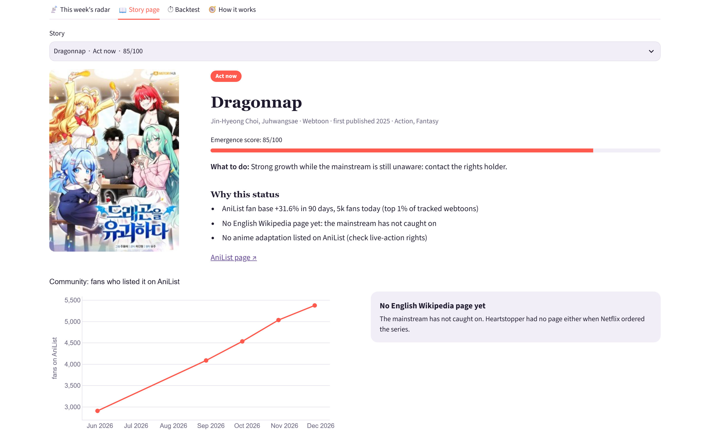
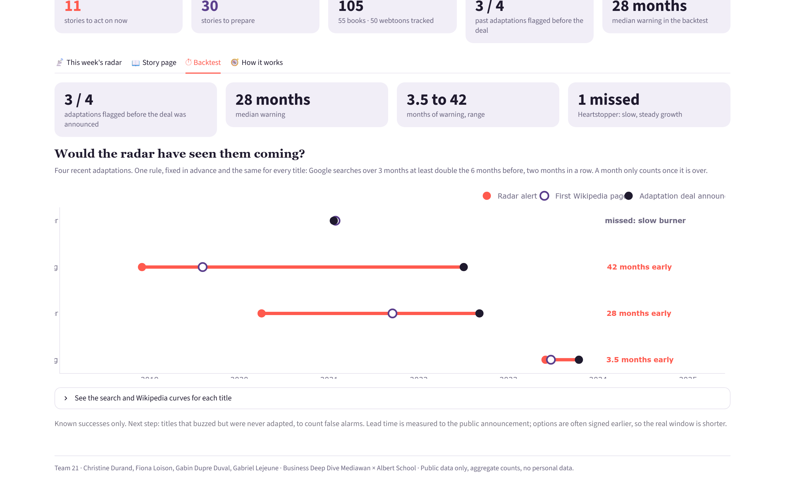

# From Social to Screen: an early-warning radar for adaptable stories

Business Deep Dive **Mediawan × Albert School** (23 November - 11 December 2026).
**Team 21:** Christine Durand, Fiona Loison, Gabin Dupre Duval, Gabriel Lejeune.

> **The decision we inform:** which book or webtoon should Mediawan's development teams look at,
> and option, this quarter, before its rights become expensive?

The radar follows stories (books, webtoons) across online communities and public data, and gives
each one a weekly emergence score and a status: **Watch**, **Prepare** or **Act now**.

## Where we are (26 November)

- Framing, benchmark, sources and method written (`docs/`).
- **Proof of concept**: with free Google Trends data and one rule fixed in advance, the radar would
  have flagged **3 of 4** recent adaptations before the deal was announced:

| Story | Radar alert | Deal announced | Warning |
|---|---|---|---|
| Solo Leveling | Dec 2018 | Jul 2022 (anime, Crunchyroll / A-1 Pictures) | 42 months |
| A Good Girl's Guide to Murder | Apr 2020 | Sep 2022 (BBC Three) | 28 months |
| Fourth Wing | Jun 2023 | Oct 2023 (Amazon MGM Studios) | 3.5 months |
| Heartstopper | not flagged (slow, steady growth) | Jan 2021 (Netflix) | missed |

- **False-alarm test** on 16 popular stories with no adaptation listed: the same rule fired for
  **11 of the 12** truly never adapted (precision 29 %), and a trade-press check showed that 4
  "controls" had in fact been optioned (The Midnight Library; Netflix's Twisted series deal,
  flagged about three years earlier). Acceleration alone is a first filter, not a decision
  (`docs/04_method.md`, section 6).
- On the Grill 1 deck, speaker script and Q&A prep (`presentation/`).
- **Story Radar prototype** (`app/`), running on live public data without API keys.

## The prototype: Story Radar



| Radar map | Story page | Backtest |
|---|---|---|
|  |  |  |

- **This week's radar**: the top signals with their reasons, a radar map (acceleration in the
  community × mainstream awareness) and the full watchlist with covers, filterable by keyword,
  format, status and genre.
- **Story page**: status, score, why, links, the community curve and the Wikipedia curve.
- **Backtest**: the four past adaptations, alert versus deal.
- **How it works**: the three questions, the status rules, the sources and their status, and a
  button to refresh the live data.

Live sources: **AniList** (webtoon fans), **Open Library** (book readers), **Wikipedia**
(mainstream gauge). Scoring rules: `docs/04_method.md`, section 4b.

**To send it by email** (no Python needed on the other side):
- `exports/story_radar.html`: the whole interface in one file (5 MB), interactive (filters, radar
  map, watchlist with reasons, backtest, false alarms). Opens in any browser.
- `exports/story_radar_screenshots.pdf`: 4 screenshots (1 MB), for mail systems that block HTML.
- Rebuild them with `python scripts/export_static.py` and `python scripts/export_screenshots_pdf.py`.

## Repository map

```
README.md
docs/
  01_framing.md            problem, decision, axis, scope, success criteria
  02_benchmark.md          existing trend tools and what they miss
  03_sources.md            sources, access, history, rules (ToS, no personal data)
  04_method.md             indicators, alert rule, score, backtest protocol, limits
  05_roadmap.md            plan to 13 December, roles
  scoping_note_draft.md    draft of the 2-4 page deliverable
  feedback_log.md          jury feedback, round by round
presentation/
  OTG1_deck.pptx           On the Grill 1 deck (7 slides + 1 backup, speaker notes included)
  assets/prototype.png     screenshot of the prototype (used in the backup slide)
  OTG1_deck.pdf            same, as PDF
  OTG1_speaker_script.md   5-minute script split between the 4 speakers (+ French version)
  OTG1_speaker_script.pdf  same, as PDF (build_script_pdf.py rebuilds it)
  OTG1_jury_QA.md          expected questions, answers, questions for the jury
  build_deck.py            regenerates the deck from the data
src/radar/
  sources/                 anilist, openlibrary, wikipedia, google_trends, youtube, reddit, nyt_bestsellers
  watchlist.py             live watchlist: Wikipedia matching, score, status, reasons
  indicators.py            momentum, alerts (backtest)
  config.py                paths and API keys (read from .env)
scripts/run_watchlist.py   builds this week's watchlist from live public data
scripts/run_poc.py         collects data and runs the backtest
scripts/run_control_test.py  false-alarm test on stories never adapted
app/streamlit_app.py       Story Radar prototype (radar, story pages, backtest, method)
.streamlit/config.toml     prototype theme (same colours as the deck)
data/
  seeds/backtest_titles.csv   adapted titles, deal dates and source links
  raw/                        collected data (backtest series, watchlist signals and history)
  processed/                  watchlist, backtest results and series used by the app and the deck
tests/test_smoke.py        indicator tests + headless run of the app
```

## Run it

**Windows, simplest:** double-click `lancer_app.bat`. The first time, it creates a Python
environment in `%USERPROFILE%\.mediawan-radar` (about 3 minutes), then it opens the prototype at
http://localhost:8501. Close its window to stop the app.

By hand:

```powershell
python -m venv .venv
.venv\Scripts\activate
pip install -r requirements.txt
streamlit run app/streamlit_app.py      # open the prototype (uses the saved data snapshot)
python scripts/run_watchlist.py         # refresh the live watchlist (about 5 minutes)
python scripts/run_poc.py --offline     # recompute the backtest from the saved snapshot
python scripts/run_poc.py               # refetch Google Trends + Wikipedia for the backtest
python presentation/build_deck.py       # rebuild the deck with the latest numbers
python tests/test_smoke.py              # checks
```

Keep the virtual environment outside OneDrive if the folder is synced, or exclude `.venv`.

For YouTube, Reddit and NYT: copy `.env.example` to `.env` and add your own keys (never commit `.env`).

## Rules we follow

Public data only, official APIs where possible, terms of use respected, aggregate counts only
(no usernames, no private individuals). The case brief belongs to Mediawan and is not in this
repository; any public post about the case needs Mediawan's approval first.

## Key dates

| Date | Milestone |
|---|---|
| Fri 27 Nov, 13:00 | On the Grill 1 (5 min + 7 min Q&A), 30 % |
| Fri 4 Dec, 11:00 | On the Grill 2: prototype demo + use of feedback |
| Thu 10 Dec, 18:00 | Final deliverables on Inside |
| Fri 11 Dec | Final at Mediawan (best teams) |
| Sun 13 Dec, 23:59 | Peer review, 20 % |

---

## En bref (français)

- **Pour vendredi** : le diapo `presentation/OTG1_deck.pptx` (notes de l'orateur incluses), le texte
  à dire `presentation/OTG1_speaker_script.md` (anglais + traduction française), et la préparation
  des questions du jury `presentation/OTG1_jury_QA.md`.
- **Le texte de l'oral en PDF** : `presentation/OTG1_speaker_script.pdf` (réparti entre les quatre
  orateurs, avec la version française).
- **Le prototype** (Story Radar) : double-cliquer sur `lancer_app.bat` (Windows), ou
  `streamlit run app/streamlit_app.py`. Il tourne sur de vraies
  données publiques de cette semaine (AniList, Open Library, Wikipedia). Une slide de secours
  (n° 8) le montre si le jury demande ce que voit l'utilisateur.
- **Pour la suite** : le plan est dans `docs/05_roadmap.md`, la note de cadrage commencée dans
  `docs/scoping_note_draft.md`.
- **Partie technique** : `src/`, `scripts/`, `app/`, à ne pas montrer dans la présentation.
